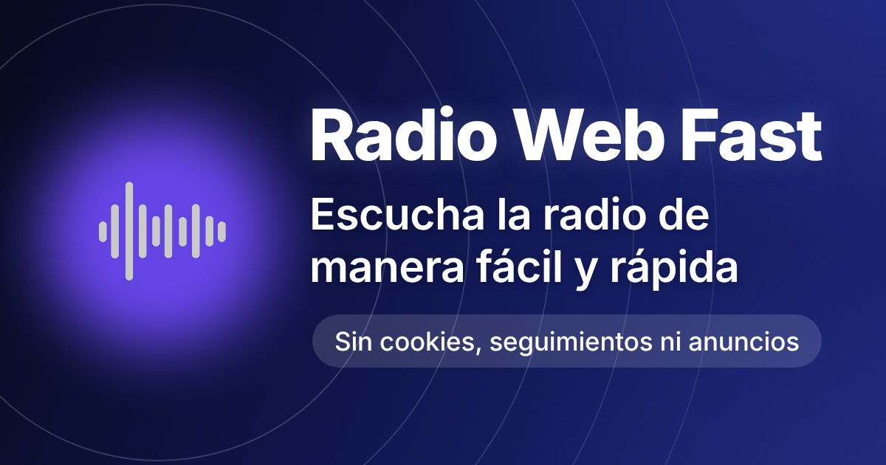

# radio_web_fast

Reproductor de radio *vibecodeado* con...

- Una lista de emisiones en directo de las principales cadenas españolas (+15 generalistas y +20 musicales)

- Página con una emisión musical o silencio y conexión automática de 8 a 20 horas a los boletines de la SER

- Siete listas de podcast: Algunas son simples visores de un feed xml, otras son selecciones para mi uso personal

- Visor del RSS oficial de la portada de El País: Las mismas noticias de la web del periódico, pero sin pesos visuales y con sus títulos completos (no los usados en la portada)

- Mapa de emisoras de la SER: No se garantiza que la información sea correcta o este 100% actualizada

> [!NOTE]
> Si quieres una aplicación más completa (ecualización personalizada, visualizador de la señal o posibilidad de buscar y añadir emisoras) mejor pasate por [Radio Web Neo](https://github.com/ManuRS/radio_web_neo). Quedate con Radio Web Fast si quieres algo directo, rápido y sin complicaciones.

### Puntos de instalación como Aplicación Web Progresiva (PWA)

- [Radio en directo](https://manurs.github.io/radio_web_fast/live/): La versión más recomendable para escuchar el catálogo de emisoras disponible

- [Aplicación completa](https://manurs.github.io/radio_web_fast/): Adaptada para mi con las listas de podcast, el visor de El País y el mapa de la SER

- [Modo sencillo](https://manurs.github.io/radio_web_fast/live_ser/): Un solo botón con el directo de la SER. Fue el germen de esta aplicación, acercar la radio a quien no puede manejar aplicaciones repletas de anuncios y menús pero tampoco radios convencionales

## Hitos

- Septiembre de 2025: Desarrollo de la primera versión utilizando las opciones gratuitas de Gemini y ChatGPT a través de la web (sin emplear paradigmas estilo Claude Code / OpenAI Codex). Se utilizaron únicamente *prompts* contra los modelos de lenguaje y sus respuestas en formato de texto, sin que los modelos tuvieran acceso a entornos ni capacidad de ejecutar comandos.

- Abril y mayo de 2026: Mejora profunda de los permisos de audio en segundo plano, automatización de la reproducción de noticias cada hora y optimización del comportamiento como Aplicación Web Progresiva (PWA) que puede ser instalada en un teléfono móvil. Todo sin modificar la arquitectura general.

- Octubre de 2026 (Fase 1): Refactorización del código, modo oscuro y librería de audio. El proyecto no estaba pensado para ser alojado en un servidor, creció poco a poco y gran parte del código se repetía en muchas de las páginas. La refactorización se realizó con mis ideas y esfuerzo, con la conversación con ChatGPT como ayudante y tester de los cambios. Es mi último gran homenaje a la programación tradicional. Migración con la librería de audio a un modelo algo más desatendido de desarrollo.

- Octubre de 2026 (Fase 2): Migración completa a un desarrollo desatendido usando Claude (Sonnet 5.5 en esfuerzo alto) para mejorar aún más la librería de audio, creando una aplicación aún más profesional y que cuenta con reconexión automática al recuperar una conexión a internet perdida. Mejoró también la gestión de las notificaciones en Android (no probado en iOS), el cálculo del *delay* de emisión online y el aspecto visual.

## Limitaciones

1. La selección de cadenas abarca prácticamente la totalidad de la audiencia según el EGM, pero no es una lista exhaustiva. Esta aplicación busca contención y no cuenta con cientos de radios. Eso provoca que no se incluyan algunas cadenas minoritarias aceptables. Tampoco hay emisoras locales y apenas hay cadenas autonómicas.

2. Tampoco permite seleccionar la emisora de una cadena. Es decir, se emite la desconexión realizada desde los estudios desde donde se produce la emisión en cadena (generalmente Madrid para las grandes cadenas). Una cadena y una emisora de radio no son lo mismo.

## Libre de rastreos

- El código no incluye cookies ni ningún otro tipo de rastreo. Solo se comunica: 1) Con los servidores de emisión de audio 2) Con los feeds de podcast 3) Con time.now en la página de conexión automática a los boletos de la SER 4) Con el feed RSS de El País en la página correspondiente 5) Con las librerías de visualización de mapas en la página de las emisoras de la SER.

- La radio en directo usa HLS.js cuando es necesario. Es una librería de código abierto y el estándar de la industria para reproducir HLS, un formato desarrollado por Apple que usan los medios que ofrecen mejor calidad y latencia en su stream. No está incluido por defecto por los navegadores. No se descarga siempre, la versión utilizada se almacena en la cache del sitio.

- Mapa versión original: utiliza la librería Leaflet y su hoja de estilos así como las teselas de OpenStreetMap.

- Mapa versión actual: utiliza Leaflet (librería y estilos), MapLibre (librería y estilos), el puente maplibre-gl-leaflet para unir ambas librerías así como las teselas positron y dark de OpenFreeMap.

- La web descarga en la primera apertura unos ~8MB que se guardan como cache del sitio. Incluye el código propio para funcionar (HTML, CSS y JavaScript), la librería externa HLS.js, los sonidos de transición y las imágenes que se usan en el menú y para seleccionar emisoras en el reproductor en directo.

- Los anuncios al escuchar un audio están siempre controlados y añadidos por la empresa que envía el correspondiente stream de audio o el podcast.
